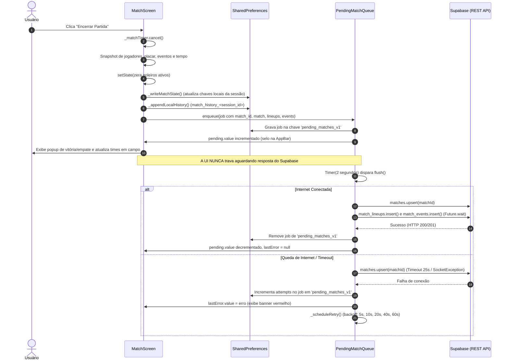

# Inventário de Comportamento Offline e Resiliência a Quedas de Conexão

Este documento descreve detalhadamente o comportamento do aplicativo durante a perda de conectividade (queda de internet) em uma partida, o funcionamento dos serviços de fila e cache, o ciclo de vida de finalização de partidas, a persistência de estado em tempo real no `MatchScreen`, e o papel dos serviços `CacheSyncManager` e `SyncService`.

---

## 1. Análise dos Serviços: Finalidade, Métodos Públicos e Chamadores

### 1.1 `lib/services/pending_match_queue.dart`

* **Finalidade**: Fila de envio assíncrono ("outbox pattern") para partidas finalizadas. Garante que o fluxo de jogo não trave esperando respostas de rede HTTP para as tabelas do Supabase. Salva a partida localmente no `SharedPreferences`, retoma a UI instantaneamente e realiza o envio em segundo plano com tentativas automáticas e backoff exponencial. Fornece leitura local das partidas pendentes para que telas de histórico e estatísticas mostrem partidas recém-terminadas antes do upload ser concluído.

* **Métodos e Propriedades Públicas**:
  | Identificador | Tipo / Assinatura | O que faz |
  |---|---|---|
  | `instance` | `static final PendingMatchQueue instance` (linha 17) | Instância singleton da fila. |
  | `pending` | `final ValueNotifier<int> pending` (linha 22) | Notificador reativo da quantidade de partidas atualmente aguardando envio. |
  | `lastError` | `final ValueNotifier<String?> lastError` (linha 25) | Notificador com a última mensagem de erro capturada durante a tentativa de envio (`null` se não houver erro). |
  | `readAll` | `static Future<List<Map<String, dynamic>>> readAll() async` (linhas 52–55) | Lê todas as partidas salvas localmente na fila pendente (chave `pending_matches_v1`) sem consultar a rede. |
  | `enqueue` | `Future<void> enqueue(Map<String, dynamic> job) async` (linhas 60–68) | Salva localmente uma partida finalizada com `attempts: 0`, atualiza `pending.value` e agenda o `flush()` para dali a 2 segundos. |
  | `flush` | `Future<void> flush() async` (linhas 71–122) | Itera sobre a fila local e tenta enviar cada partida ao Supabase via `MatchesRepository.savePendingMatch`. Gerencia contadores de tentativas, atualiza erros e agenda reenvio em caso de falha. |

* **Chamadores**:
  | Arquivo | Linha | Chamada | Contexto |
  |---|---|---|---|
  | `lib/repositories/matches_repository.dart` | 26 | `final jobs = await PendingMatchQueue.readAll();` | Executado no método `_pendingMatches()` para mesclar partidas ainda não enviadas nas consultas de histórico (`getMatchesBySession`) e estatísticas (`getMatchesByGroup`). |
  | `lib/screens/match_screen.dart` | 129 | `PendingMatchQueue.instance.flush();` | Chamado no `initState()` ao abrir a tela de partida para descarregar partidas pendentes de sessões anteriores. |
  | `lib/screens/match_screen.dart` | 605 | `PendingMatchQueue.instance.flush();` | Chamado em `_startMatch()` quando a bola começa a rolar em uma nova partida. |
  | `lib/screens/match_screen.dart` | 1705 | `valueListenable: PendingMatchQueue.instance.pending,` | Exibe selo/contador na AppBar informando partidas aguardando envio. |
  | `lib/screens/match_screen.dart` | 3418 | `await PendingMatchQueue.instance.enqueue({...});` | Chamado em `_finishMatch()` ao concluir a partida atual para enfileirar súmula, escalações e eventos. |
  | `lib/screens/match_screen.dart` | 3660 | `if (isMatchRunning \|\| PendingMatchQueue.instance.pending.value > 0)` | Impede agendamento de sincronização do site enquanto houver itens pendentes na fila. |
  | `lib/screens/match_screen.dart` | 3676 | `valueListenable: PendingMatchQueue.instance.pending,` | Monitora a quantidade de partidas pendentes para renderizar o banner de alerta `_buildSyncWarningBanner()`. |
  | `lib/screens/match_screen.dart` | 3678 | `valueListenable: PendingMatchQueue.instance.lastError,` | Monitora a mensagem de erro para exibir no banner de alerta. |
  | `lib/screens/match_screen.dart` | 3690 | `onPressed: () => PendingMatchQueue.instance.flush(),` | Botão "Reenviar agora" no banner de alerta de falha de conexão. |

---

### 1.2 `lib/services/cache_store.dart` (e Equivalentes)

* **Finalidade**: Armazenamento genérico em cache ("read-through") persistido no `SharedPreferences` sob chaves com prefixo `cache:`. Salva o envelope com o dado JSON e a data de gravação (`cachedAt`). Utilizado pelos repositórios como plano de contingência caso a requisição ao Supabase falhe por perda de conectividade.

* **Métodos Públicos**:
  | Identificador | Assinatura | O que faz |
  |---|---|---|
  | `write` | `Future<void> write(String key, dynamic value) async` (linhas 22–29) | Serializa `value` com timestamp `cachedAt` na chave `cache:$key`. |
  | `read` | `Future<CachedValue?> read(String key) async` (linhas 33–46) | Lê a chave `cache:$key`, decodifica o envelope e retorna uma instância de `CachedValue` ou `null`. |
  | `invalidate` | `Future<void> invalidate(String key) async` (linhas 50–53) | Remove a entrada específica `cache:$key`. |
  | `clearAll` | `Future<void> clearAll() async` (linhas 57–63) | Itera sobre todas as chaves do `SharedPreferences` que começam com `cache:` e as deleta. |
  | `CachedValue.asMapList` | `List<Map<String, dynamic>> asMapList()` (linhas 74–80) | Converte o valor do envelope para uma lista de Maps. |
  | `CachedValue.asMap` | `Map<String, dynamic>? asMap()` (linhas 83–86) | Converte o valor do envelope para um Map isolado. |

* **Chamadores**:
  | Arquivo | Linha | Chamada | Contexto |
  |---|---|---|---|
  | `lib/repositories/matches_repository.dart` | 64 | `await _cache.write(cacheKey, raw);` | Grava partidas da sessão em cache após busca bem-sucedida no Supabase. |
  | `lib/repositories/matches_repository.dart` | 68 | `await _cache.read(cacheKey);` | Fallback para carregar partidas da sessão do cache caso a rede falhe. |
  | `lib/repositories/matches_repository.dart` | 131 | `await _cache.write(cacheKey, rawMatches);` | Grava partidas do grupo em cache após consulta ao Supabase. |
  | `lib/repositories/matches_repository.dart` | 140 | `await _cache.read(cacheKey);` | Fallback para carregar partidas do grupo do cache caso a rede falhe. |
  | `lib/repositories/sessions_repository.dart` | 20 | `await _cache.read('session:$sessionId');` | Leitura da sessão em cache sem tocar na rede em `getCachedSession`. |
  | `lib/repositories/sessions_repository.dart` | 29 | `await _cache.write('session:$id', row);` | Grava os dados de uma sessão específica no cache via `_cacheRow`. |
  | `lib/repositories/sessions_repository.dart` | 48 | `return getCachedSession(sessionId);` | Fallback em `getSessionById` caso a busca remota falhe. |
  | `lib/repositories/sessions_repository.dart` | 84 | `await _cache.write(listKey, rows);` | Grava lista de sessões do grupo no cache. |
  | `lib/repositories/sessions_repository.dart` | 90 | `await _cache.read(listKey);` | Fallback em `getSessionsByGroup` se o Supabase falhar. |
  | `lib/repositories/players_repository.dart` | 59, 77 | `await _cache.write(cacheKey, rawPlayers);` | Grava lista de jogadores do grupo no cache após consulta. |
  | `lib/repositories/players_repository.dart` | 64, 80 | `await _cache.read(cacheKey);` | Fallback em `getPlayersByGroup` para restaurar elenco caso a rede falhe. |

* **Serviço Equivalente de Snapshot Offline: `GroupBootstrap` (`lib/services/group_bootstrap.dart`)**:
  * **O que faz**: Realiza a carga inicial do grupo ("prefetch") e salva um snapshot completo no `SharedPreferences` (`players_$groupId` e `ratings_snapshot_at_$groupId`). Contém o elenco completo com `rating`, `overall` pré-calculado e atributos da comunidade. Isso permite que sorteios, draft e montagem de times ocorram na tela de partida com zero dependência de rede.
  * **Chamadores**:
    - `lib/screens/group_dashboard_screen.dart:42`: `GroupBootstrap.instance.prefetch(widget.groupId, force: true);` ao abrir o grupo.
    - `lib/screens/group_dashboard_screen.dart:111`: monitora `GroupBootstrap.instance.status` via `ValueListenableBuilder`.
    - `lib/screens/match_screen.dart:353, 356, 359`: checa `hasLocalSnapshot(widget.groupId)` e aciona `prefetch` ao entrar na partida.
    - `lib/screens/match_screen.dart:2802`: converte jogadores para o formato do snapshot local.
    - `lib/screens/season_stats_screen.dart:216, 849`: utiliza `GroupBootstrap.playerSnapshotMap` para dados locais de tela.

---

### 1.3 `lib/services/cache_sync_manager.dart`

* **Finalidade**: Gerenciador de diagnóstico de conectividade com o Supabase e monitoramento de sincronização de dados locais. Executa testes de ping na nuvem e coleta estatísticas de armazenamento para telas administrativas.

* **Métodos e Propriedades Públicas**:
  | Identificador | Assinatura | O que faz |
  |---|---|---|
  | `markDirty` | `Future<void> markDirty() async` (linhas 37–40) | Define a flag `cache_has_pending_cloud_sync = true` no `SharedPreferences`. |
  | `recordCloudSyncSuccess` | `Future<void> recordCloudSyncSuccess() async` (linhas 43–47) | Define a flag `cache_has_pending_cloud_sync = false` e atualiza `cache_last_cloud_sync_at` com o timestamp atual. |
  | `recordCloudFetchSuccess` | `Future<void> recordCloudFetchSuccess() async` (linhas 50–54) | Define a flag `cache_has_pending_cloud_sync = false` e atualiza `cache_last_cloud_fetch_at` com o timestamp atual. |
  | `testSupabaseConnection` | `Future<Map<String, dynamic>> testSupabaseConnection() async` (linhas 57–76) | Executa `select('sync_code').limit(1)` na tabela `sync_data` medindo o tempo em milissegundos (`ping`). Retorna Map com `connected`, `ping` e `error`. |
  | `getStatus` | `Future<CacheSyncStatus> getStatus() async` (linhas 79–96) | Consolida o status completo de conexão, latência, flags de pendência e total de chaves locais do `SharedPreferences`. |
  | `getDebugStorageDump` | `Future<Map<String, String>> getDebugStorageDump() async` (linhas 99–113) | Retorna um dump de todas as chaves e valores armazenados no `SharedPreferences` para inspeção na tela de debug. |

* **Chamadores**:
  | Arquivo | Linha | Chamada | Contexto |
  |---|---|---|---|
  | `lib/services/sync_service.dart` | 16 | `final CacheSyncManager _cacheSyncManager = CacheSyncManager();` | Instanciação do gerenciador dentro do serviço de sincronização legada. |
  | `lib/services/sync_service.dart` | 41 | `await _cacheSyncManager.recordCloudSyncSuccess();` | Disparado ao concluir `exportDataToSupabase`. |
  | `lib/services/sync_service.dart` | 88 | `await _cacheSyncManager.recordCloudFetchSuccess();` | Disparado ao concluir `importDataFromSupabase`. |
  | `lib/screens/admin_debug_screen.dart` | 20 | `final CacheSyncManager _cacheSyncManager = CacheSyncManager();` | Instanciação na tela de debug administrativo. |
  | `lib/screens/admin_debug_screen.dart` | 36 | `final status = await _cacheSyncManager.getStatus();` | Coleta de métricas e status para exibição no painel de debug. |
  | `lib/screens/admin_debug_screen.dart` | 38 | `final dump = await _cacheSyncManager.getDebugStorageDump();` | Coleta do dump de chaves locais para exibição no inspetor de storage. |
  | `lib/screens/admin_debug_screen.dart` | 60 | `final result = await _cacheSyncManager.testSupabaseConnection();` | Disparado no botão "TESTAR CONEXÃO AGORA" para medir latência da conexão Supabase. |

---

### 1.4 `lib/services/sync_service.dart`

* **Finalidade**: Serviço monolítico de exportação e importação de todo o banco local (`SharedPreferences`) para um documento JSON único na tabela `sync_data` do Supabase ou para arquivo `.json` local no aparelho. Código remanescente de arquitetura anterior à migração para tabelas relacionais do Supabase.

* **Métodos Públicos**:
  | Identificador | Assinatura | O que faz |
  |---|---|---|
  | `exportDataToSupabase` | `Future<void> exportDataToSupabase(String syncCode) async` (linhas 20–42) | Varre todas as chaves do `SharedPreferences`, gera o JSON do site via `SiteDataGenerator` e faz `upsert` na tabela `sync_data` com o código informado. |
  | `importDataFromSupabase` | `Future<void> importDataFromSupabase(String syncCode) async` (linhas 45–89) | Baixa o registro da tabela `sync_data` por `sync_code`, limpa o `SharedPreferences` local (`prefs.clear()`) e reescreve todas as chaves importadas. |
  | `getOrCreateSyncCode` | `Future<String> getOrCreateSyncCode() async` (linhas 94–127) | Retorna ou gera um código de sincronização no formato `SNC` + 4 dígitos finais do timestamp atual, salvando na chave `my_sync_code`. |
  | `exportToFile` | `Future<void> exportToFile() async` (linhas 130–154) | Grava todo o `SharedPreferences` em um arquivo temporário `pelada_backup_<timestamp>.json` e abre o diálogo de compartilhamento do sistema (`Share.shareXFiles`). |
  | `importFromFile` | `Future<bool> importFromFile() async` (linhas 157–208) | Abre seletor de arquivos (`FilePicker`), lê o arquivo `.json` selecionado, limpa o `SharedPreferences` local e reescreve os dados. |

* **Chamadores**:
  | Arquivo | Linha | Chamada | Contexto |
  |---|---|---|---|
  | `lib/main.dart` | 154 | `final SyncService _syncService = SyncService();` | Declarado no estado de `HomePage`, porém **nunca utilizado** em nenhuma linha subsequente do arquivo. |
  | `lib/screens/admin_debug_screen.dart` | 21, 39 | `final code = await _syncService.getOrCreateSyncCode();` | Obtém o código de sincronização para exibir no card de informações de debug administrativo. |
  | `lib/screens/sync_screen.dart` | 14 | `final SyncService _syncService = SyncService();` | Instanciação na tela de sincronização na nuvem. |
  | `lib/screens/sync_screen.dart` | 28 | `final code = await _syncService.getOrCreateSyncCode();` | Carrega o código da sessão no `initState()`. |
  | `lib/screens/sync_screen.dart` | 42 | `await _syncService.exportDataToSupabase(_mySyncCode!);` | Botão "ENVIAR PARA NUVEM". |
  | `lib/screens/sync_screen.dart` | 107 | `await _syncService.importDataFromSupabase(codeToImport);` | Botão "BAIXAR DA NUVEM". |
  | `lib/screens/match_screen.dart` | 3999–4001 | `syncService.exportDataToSupabase(code)` | Chamado em `_triggerBackgroundSync()` silenciosamente em segundo plano após timer de 90 segundos ou no `dispose()` da tela. |

---

## 2. Fluxo Completo de "Finalizar Partida"

O encerramento de uma partida é iniciado pelo usuário ao tocar no botão **"Encerrar Partida"** (`lib/screens/match_screen.dart:1054`), que invoca o método `_finishMatch()` (`lib/screens/match_screen.dart:3345–3490`).



### 2.1 O que é gravado localmente

1. **Cancelamento do Timer**: O cronômetro em memória `_matchTimer?.cancel()` é finalizado (`match_screen.dart:3346`).
2. **Snapshot Imutável**: Variáveis locais (`gkRedSnap`, `gkWhiteSnap`, `redSnap`, `whiteSnap`, `eventsSnap`, `redScoreSnap`, `whiteScoreSnap`, `durationSnap`, `startedAtSnap`) são congeladas antes de qualquer alteração de estado (`match_screen.dart:3350–3359`).
3. **Persistência de Estado Local via `_saveMatchState()`**: Executa `_writeMatchState()` (`match_screen.dart:224–260`), gravando no `SharedPreferences`:
   - `present_players_$id`
   - `team_red_$id`
   - `team_white_$id`
   - `score_red_$id`
   - `score_white_$id`
   - `match_events_$id`
   - `is_overtime_$id`
   - `seconds_played_$id`
   - `is_running_$id`
   - Remove `start_timestamp_$id`, `active_gk_red_$id`, `active_gk_white_$id`, `first_gk_red_$id` e `first_gk_white_$id`.
4. **Enfileiramento no Outbox (`PendingMatchQueue.instance.enqueue`)**:
   - Gera um novo UUID v4 para a partida (`final String matchId = const Uuid().v4();`, linha 3384).
   - Monta `lineupMaps` com os modelos `MatchLineupModel` e `eventMaps` com `MatchEventModel`.
   - Adiciona o payload completo no `SharedPreferences` sob a chave `pending_matches_v1` (`pending_match_queue.dart:62–63`) com `attempts: 0`.
   - Atualiza o notificador `pending.value = jobs.length;`.
   - Agenda o disparo do `flush()` para dali a 2 segundos: `_retryTimer = Timer(const Duration(seconds: 2), flush);` (`pending_match_queue.dart:67`).
5. **Backup Local do Histórico**: Chama `unawaited(_appendLocalHistory(matchRecord))` (`match_screen.dart:3434`), gravando a partida na lista JSON sob a chave `match_history_${widget.tournamentId}`.
6. **Atualização de Fila de Espera em Memória**: Cria uma entrada `FinishedMatchInfo` e adiciona em `_finishedMatches` para calcular tempos de banco dos jogadores para a próxima partida (`match_screen.dart:3437–3447`).
7. **Liberação da UI**: Popups de vitória ou empate, cálculo de streak e rotação de times em campo ocorrem imediatamente sem nenhum atraso de rede.

### 2.2 O que vai para o Supabase

Quando o `PendingMatchQueue.instance.flush()` é executado (`pending_match_queue.dart:71–122`):
* Invoca `SupabaseService.instance.matches.savePendingMatch(...)` (`lib/repositories/matches_repository.dart:164–190`) com timeout rígido de 25 segundos:
  1. **Tabela `matches`**: Envia `upsert` com os dados:
     - `id`: UUID gerado no aplicativo.
     - `session_id`: UUID da pelada.
     - `group_id`: UUID do grupo.
     - `score_red`: Gols do time vermelho.
     - `score_white`: Gols do time branco.
     - `played_at`: Data e hora de início em formato ISO 8601.
     - `duration_seconds`: Segundos jogados.
  2. **Se for retry (`attempts > 0`)**: Executa em paralelo (`Future.wait`) a limpeza de resíduos anteriores:
     - `delete().eq('match_id', matchId)` na tabela `match_lineups`.
     - `delete().eq('match_id', matchId)` na tabela `match_events`.
  3. **Tabelas de Detalhe**: Executa em paralelo (`Future.wait`):
     - `insert` de todos os registros na tabela `match_lineups` (`player_id`, `team`, `is_goalkeeper`).
     - `insert` de todos os registros na tabela `match_events` (`player_id`, `assist_player_id`, `event_type`, `team`, `minute`).

### 2.3 O que acontece se a chamada falhar

Se a internet cair, o timeout de 25s estourar ou o servidor retornar erro:
1. `savePendingMatch` lança uma exceção.
2. O bloco `catch (e)` em `PendingMatchQueue.flush()` (`pending_match_queue.dart:105–117`) intercepta o erro.
3. O contador `attempts` do job correspondente é incrementado em 1 e atualizado no `SharedPreferences` (`pending_matches_v1`).
4. O job **não é removido** da lista local de pendências.
5. `lastError.value` recebe a mensagem de erro convertida em texto (`pending_match_queue.dart:114`).
6. A tela `MatchScreen` reage automaticamente através de `ValueListenableBuilder`:
   - A AppBar exibe um selo indicando a contagem de partidas pendentes (`match_screen.dart:1705`).
   - O rodapé da tela renderiza o banner vermelho de alerta `_buildSyncWarningBanner()` (`match_screen.dart:3650–3700`), informando a falha de envio e exibindo o botão "Reenviar agora".
7. As telas de Histórico, Ranking e Estatísticas continuam exibindo a partida finalizada: `MatchesRepository._pendingMatches()` (`matches_repository.dart:25–45`) lê os jobs salvos localmente em `PendingMatchQueue.readAll()` e os mescla em memória com as partidas carregadas do cache local.

### 2.4 Quando e como a fila tenta de novo

A fila tenta o reenvio nos seguintes cenários:
1. **Backoff Exponencial Automático**: O método `_scheduleRetry()` (`pending_match_queue.dart:124–129`) agenda um timer para executar `flush()`. O tempo de espera inicia em 5 segundos e dobra a cada tentativa consecutiva falha (`5s -> 10s -> 20s -> 40s -> 60s`), limitado a um teto de 60 segundos.
2. **Ao Abrir a Tela da Partida**: O método `initState()` de `_MatchScreenState` (`match_screen.dart:129`) dispara `PendingMatchQueue.instance.flush()`.
3. **Ao Iniciar Nova Partida**: O método `_startMatch()` (`match_screen.dart:605`) dispara `PendingMatchQueue.instance.flush()` no momento em que a bola começa a rolar.
4. **Ao Voltar do Background**: O método `_onAppResumed()` em `match_screen.dart` aciona o reenvio quando o app volta a ter foco no sistema operacional.
5. **Reenvio Manual pelo Usuário**: O botão "Reenviar agora" no banner de alerta (`match_screen.dart:3690`) invoca diretamente `PendingMatchQueue.instance.flush()`.

---

## 3. Estado em Andamento no `MatchScreen`: Persistência Local e Restauração

Enquanto uma pelada e suas partidas estão rolando, o `MatchScreen` mantém o estado atualizado em persistência local para garantir tolerância a fechamentos inesperados do aplicativo, descarregamento de memória pelo sistema operacional ou falta de internet.

### 3.1 O que é gravado localmente durante a partida

Toda ação na partida (tick do cronômetro, gol marcado, gol contra, cartão, substituição, desistência, troca de times ou pausa) invoca `_saveMatchState()` (`lib/screens/match_screen.dart:208–222`), que executa `_writeMatchState()` (linhas 224–260) gravando no `SharedPreferences`:

| Chave no `SharedPreferences` | Tipo de Dado | Conteúdo Armazenado |
|---|---|---|
| `present_players_${tournamentId}` | String (JSON) | Lista completa de jogadores confirmados na pelada, incluindo a flag `desistiu: true/false`. |
| `team_red_${tournamentId}` | String (JSON) | Lista dos jogadores atualmente escalados na linha do time vermelho. |
| `team_white_${tournamentId}` | String (JSON) | Lista dos jogadores atualmente escalados na linha do time branco. |
| `score_red_${tournamentId}` | `int` | Placar atual do time vermelho na partida em andamento. |
| `score_white_${tournamentId}` | `int` | Placar atual do time branco na partida em andamento. |
| `match_events_${tournamentId}` | String (JSON) | Linha do tempo de eventos da partida atual (gols, assistências, cartões e minutos). |
| `is_overtime_${tournamentId}` | `bool` | Flag indicando se a partida ultrapassou a duração limite e está em prorrogação. |
| `seconds_played_${tournamentId}` | `int` | Quantidade de segundos acumulados jogados antes da última pausa (`_secondsPlayedBeforePause`). |
| `is_running_${tournamentId}` | `bool` | Flag indicando se o cronômetro está em contagem ativa (`isMatchRunning`). |
| `start_timestamp_${tournamentId}` | String (ISO 8601) | Momento exato em que o cronômetro foi iniciado (`_lastStartTime`). Removido da storage se o timer for pausado. |
| `red_streak_${tournamentId}` | `int` | Sequência atual de vitórias seguidas do time vermelho. |
| `white_streak_${tournamentId}` | `int` | Sequência atual de vitórias seguidas do time branco. |
| `active_gk_red_${tournamentId}` | String (JSON) | Jogador atualmente atuando como goleiro do time vermelho (ou chave removida se nulo). |
| `active_gk_white_${tournamentId}` | String (JSON) | Jogador atualmente atuando como goleiro do time branco (ou chave removida se nulo). |
| `first_gk_red_${tournamentId}` | String (JSON) | Goleiro titular que iniciou a partida pelo time vermelho (ou chave removida se nulo). |
| `first_gk_white_${tournamentId}` | String (JSON) | Goleiro titular que iniciou a partida pelo time branco (ou chave removida se nulo). |

*Sincronização em segundo plano na nuvem (`_scheduleCloudSync`)*: A cada escrita local, um timer de 5 segundos de debounce (`match_screen.dart:268–272`) tenta atualizar o rascunho remoto no Supabase via `SessionArrivalsRepository.replaceArrivals` e `SessionsRepository.updateRuntimeState`. Se houver queda de internet, o erro é capturado silenciosamente (`debugPrint`) e o jogo continua baseado exclusivamente nos dados locais.

### 3.2 Como restaura se o app fechar ou a internet cair

A recuperação é realizada em `_loadMatchState()` (`lib/screens/match_screen.dart:331–539`):

#### Caso A: App fechado/reiniciado no mesmo aparelho (com dados locais)
1. O método verifica `prefs.containsKey('present_players_$id')` (`match_screen.dart:450`).
2. Reconstrói as listas `presentPlayers`, `teamRed`, `teamWhite` e `matchEvents` diretamente das chaves JSON locais.
3. Restaura placares (`scoreRed`, `scoreWhite`), sequências (`redWinStreak`, `whiteWinStreak`), goleiros (`activeGkRed`, `activeGkWhite`, `firstGkRed`, `firstGkWhite`) e prorrogação (`isOvertime`).
4. **Restauração do Cronômetro**:
   - Carrega `_secondsPlayedBeforePause = prefs.getInt('seconds_played_$id') ?? 0;` (linha 512).
   - Carrega `isMatchRunning = prefs.getBool('is_running_$id') ?? false;` (linha 513).
   - Carrega `_lastStartTime = stamp != null ? DateTime.parse(stamp) : null;` (linha 516).
   - Se a partida estava rodando quando o app foi fechado (`isMatchRunning && _lastStartTime != null`, linhas 526–537):
     - Reinicia o `_matchTimer = Timer.periodic(const Duration(seconds: 1), ...)`.
     - O tempo total transcorrido é calculado dinamicamente pelo getter:
       ```dart
       // lib/screens/match_screen.dart:111-116
       int get totalSecondsElapsed {
         if (!isMatchRunning || _lastStartTime == null)
           return _secondsPlayedBeforePause;
         return _secondsPlayedBeforePause +
             DateTime.now().difference(_lastStartTime!).inSeconds;
       }
       ```
     - O cronômetro não é zerado nem perde tempo: ele calcula a diferença entre o momento atual e a data/hora original de início, recuperando os segundos exatos decorridos enquanto o aplicativo esteve suspenso ou fechado.

#### Caso B: Storage local limpo ou sessão aberta em outro aparelho (contingência remota)
1. Se `!prefs.containsKey('present_players_$id')` (`match_screen.dart:376`), busca o rascunho na nuvem:
   - Consulta `SessionArrivalsRepository.getArrivals(id)` (linhas 378–379).
   - Consulta `client.from('sessions').select('seconds_played,is_running,score_red,score_white,red_streak,white_streak,is_overtime,started_at')` (linhas 410–415).
2. Hidrata os IDs retornados com o elenco do snapshot local (`allSavedPlayers`).
3. Grava as chaves locais no `SharedPreferences` para que passem a existir localmente.
4. Define `is_running = false` e remove `start_timestamp_$id` (linhas 419 e 433) por precaução, garantindo que o cronômetro não volte rodando descontroladamente devido a diferenças de horário entre aparelhos distintos. O usuário pressiona o play para continuar a partida.

---

## 4. Uso do `CacheSyncManager` (Ping de Conexão)

### 4.1 Onde é utilizado e para quê

O `CacheSyncManager` (`lib/services/cache_sync_manager.dart`) é instanciado em apenas dois locais no código:

1. **`lib/services/sync_service.dart`** (linha 16):
   - Linha 41: `await _cacheSyncManager.recordCloudSyncSuccess();` ao finalizar a exportação manual para `sync_data`.
   - Linha 88: `await _cacheSyncManager.recordCloudFetchSuccess();` ao finalizar a importação manual de `sync_data`.
2. **`lib/screens/admin_debug_screen.dart`** (linha 20):
   - Linha 36: `final status = await _cacheSyncManager.getStatus();` para montar o card de status do diagnóstico.
   - Linha 38: `final dump = await _cacheSyncManager.getDebugStorageDump();` para listar todas as chaves e valores no inspetor de dados locais.
   - Linha 60: `final result = await _cacheSyncManager.testSupabaseConnection();` acionado especificamente pelo botão **"TESTAR CONEXÃO AGORA"** (`admin_debug_screen.dart:121`) na interface de debug de administrador para medir a latência em milissegundos da requisição `.from('sync_data').select('sync_code').limit(1)`.

### 4.2 Dispara o reenvio da fila?

* **Fato**: **NÃO**. O `CacheSyncManager` **não dispara o reenvio da fila** e não possui nenhuma referência ou integração com `PendingMatchQueue`.
* O reenvio de partidas na fila é gerido exclusivamente por:
  - O timer interno de `PendingMatchQueue._scheduleRetry()` (`pending_match_queue.dart:126`).
  - O `initState()` de `MatchScreen` (`match_screen.dart:129`).
  - O início de partida `_startMatch()` (`match_screen.dart:605`).
  - O botão manual "Reenviar agora" do banner de alerta (`match_screen.dart:3690`).

---

## 5. Uso do `SyncService` (Telas, Botões e Acesso do Usuário Comum)

### 5.1 Onde é utilizado no código

| Arquivo | Linhas | Utilização |
|---|---|---|
| `lib/main.dart` | 154 | Instancia `final SyncService _syncService = SyncService();` na classe `_HomePageState`, porém a variável **nunca é chamada** em nenhuma outra linha do arquivo (código morto). |
| `lib/screens/admin_debug_screen.dart` | 21, 39 | Instancia `_syncService` e chama `await _syncService.getOrCreateSyncCode();` apenas para obter a String do código do dispositivo e exibi-la em texto no painel de administração. Não há botões de disparo de exportação/importação nesta tela. |
| `lib/screens/sync_screen.dart` | 14, 28, 42, 107 | Tela dedicada contendo a interface completa de sincronização: botão **"ENVIAR PARA NUVEM"** (`_exportData`) e botão **"BAIXAR DA NUVEM"** (`_importData`). |
| `lib/screens/match_screen.dart` | 3999–4005 | Instancia `final syncService = SyncService();` dentro do método privado `_triggerBackgroundSync()`, chamando `getOrCreateSyncCode()` e `exportDataToSupabase(code)`. |

### 5.2 O usuário comum chega a usá-lo através de telas ou botões?

* **Fato**: **NÃO através de telas ou botões**.
  - A tela `SyncScreen` (`lib/screens/sync_screen.dart`), onde residem os botões visíveis de exportação e restauração da nuvem, é uma tela orfã: **nenhuma rota, botão, menu ou chamada de `Navigator.push` em todo o aplicativo navega até ela**. Nem administradores nem membros comuns conseguem abrir essa tela pela UI.
  - O painel de debug administrativo (`AdminDebugScreen`) apenas lê a string do código de sincronização (`getOrCreateSyncCode()`) para exibição textual, sem botões de exportar ou restaurar via `SyncService`.
  - A única execução de fato do `SyncService` no aplicativo ocorre de forma **100% invisível e em segundo plano** em `MatchScreen._triggerBackgroundSync()` (`match_screen.dart:3996–4009`), acionada automaticamente por um timer periódico de 90 segundos do site (`_scheduleSiteSync`) ou quando a tela de partida é fechada (`dispose()`). O usuário comum não interage com nenhum botão ou tela relacionado a esse serviço.
